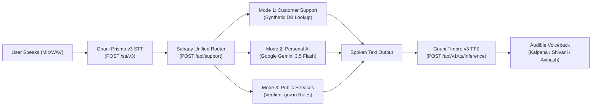

# SAHAAY AI (సహాయ్ AI / सहाय AI)
### *One Voice, Three Solutions — India's Multilingual Voice Assistance Platform*

**Challenge Submission:** Great Indian AI Internship Challenge by **Gnani.ai**  
**Tagline:** *"One Voice, Three Solutions. Your language. Your voice. Your solution."*  
**Visual Identity:** 3D Golden Infinity Symbol (∞) on Champagne Gold (`#F4E3B2`), Soft Gold (`#FFF0C7`), Metallic Gold (`#D4AF37`), Soft Beach Sand (`#F3E7D3`), and Dark Red (`#812637`).

---

## 🌊 Overview

**Sahaay AI** is a unified multilingual AI voice assistance platform designed specifically for Indian citizens, customers, and learners. It delivers **three distinct assistance modes** powered by a single, seamless voice processing pipeline:

1. **Customer Support (Logistics & Orders)**: Instant live resolution for delivery delays, shipment tracking, refund status, and order cancellations grounded in a deterministic synthetic logistics database.
2. **Personal AI Assistant (Conversational Intelligence)**: Open-ended conversational reasoning powered by the official **Google Gen AI SDK (`@google/genai`)** (`gemini-3.5-flash` / `gemini-3.5-flash-lite`). It handles geography (*"Where is India on the world map?"*), math, science, programming, and career advice with multi-turn session context.
3. **Public Services Guidance (Citizen Services)**: Step-by-step procedural guides for official Indian government portals — Civil Registration System Birth Certificates ([crsorgi.gov.in](https://crsorgi.gov.in)), UIDAI Aadhaar updates ([uidai.gov.in](https://uidai.gov.in)), and National Scholarships ([scholarships.gov.in](https://scholarships.gov.in)).

Customers speak naturally in **Telugu (తెలుగు)**, **Hindi (हिन्दी)**, or **Indian English**. Voice audio is transcribed using **Gnani Prisma v3**, analyzed by the requested mode, and spoken back using **Gnani Timbre v3** native Indian speech synthesis.

---

## 🎙️ Shared Voice & Intelligence Pipeline



---

## 🚀 Key Features

### 1. Minimal 3D Golden Infinity Symbol (∞)
- Built with lightweight, crash-proof **CSS 3D & SVG** inside [`src/components/GoldenInfinity3D.tsx`](file:///C:/hackathons/sahaay-ai/src/components/GoldenInfinity3D.tsx).
- Features a **symmetrical 3D infinity loop** with rounded metallic-gold cylindrical shading, champagne highlights, and soft ambient drop shadows.
- Gentle floating levitation and subtle slow side-to-side tilt (`animate-infinity-float`).
- Zero WebGL overhead, zero GPU context collision risk, and automatically respects `prefers-reduced-motion`.

### 2. Multi-Turn Conversational Context & Session Reset
- Maintains active conversation history across turns in Personal AI mode.
- Correctly answers contextual follow-up questions (e.g., *"What is the capital of Japan? $\rightarrow$ Tokyo"* followed by *"What was the capital you mentioned earlier? $\rightarrow$ The capital I mentioned earlier is Tokyo!"*).
- Interactive **"Reset Conversation"** controls clear active history when starting a fresh inquiry.

### 3. Native Multilingual Voice Engine
- **Gnani Prisma v3 STT**: Real-time 16-bit PCM WAV (16kHz Mono) transcription via `POST https://api.vachana.ai/stt/v3` (~150ms latency).
- **Gnani Timbre v3 TTS**: Native Indian voice synthesis via `POST https://api.vachana.ai/api/v1/tts/inference` using verified regional voices:
  - `Kalpana` — Telugu (`te-IN`)
  - `Shivani` — Hindi (`hi-IN`)
  - `Avinash` — Indian English (`en-IN`)
- **Audio Source Transparency**: The UI clearly displays whether audio was generated via genuine `Gnani Timbre` or browser fallback.

### 4. Deterministic Logistics Grounding
- To prevent AI hallucinations in logistics, order inquiries deterministically look up synthetic records (`ORD-7821`, `ORD-9104`, `ORD-5532`, `ORD-3319`) from `demoOrders.ts`.
- Extracts order IDs accurately across Telugu, Hindi, and English speech.
- Unrecognized order IDs trigger clear explanations inviting the customer to test valid demo records.

---

## 🧪 Master Verification Test Matrix (14 / 14 PASSED — 100%)

All 14 core capabilities were verified against the live Next.js server with configured Gnani and Gemini credentials:

| # | Category | Test Scenario | Verified Result | Provider / Details |
| :-: | :--- | :--- | :-: | :--- |
| 1 | **System Health** | API & Credentials Diagnostics | **PASS** ✅ | Gnani configured (`Active`), Gemini configured (`Active`), server reachable |
| 2 | **Personal AI** | Q1: *"Where can I find India on the world map?"* | **PASS** ✅ | `Google Gemini (gemini-3.5-flash)` (South Asia, Northern Hemisphere) |
| 3 | **Personal AI** | Q2: *"What is the capital of Japan?"* | **PASS** ✅ | `Google Gemini (gemini-3.5-flash)` (Tokyo) |
| 4 | **Personal AI** | Q3: *"Explain quantum computing in simple words."* | **PASS** ✅ | `Google Gemini (gemini-3.5-flash)` (Qubits, Superposition) |
| 5 | **Personal AI** | Q4: *"Write Python code to find prime numbers."* | **PASS** ✅ | `Google Gemini (gemini-3.5-flash)` (`def is_prime(n):...`) |
| 6 | **Personal AI** | Q5: *"How can I prepare for an interview?"* | **PASS** ✅ | `Google Gemini (gemini-3.5-flash-lite)` (STAR framework, fundamentals) |
| 7 | **Personal AI** | Q6: *"భారతదేశ రాజధాని ఏది?"* | **PASS** ✅ | `Google Gemini (gemini-3.5-flash)` (**న్యూఢిల్లీ**) |
| 8 | **Personal AI** | Q7: *"मशीन लर्निंग क्या है?"* | **PASS** ✅ | `Google Gemini (gemini-3.5-flash-lite)` (डेटा से पैटर्न सीखना) |
| 9 | **Personal AI** | Q8: *"What is 25 multiplied by 17?"* | **PASS** ✅ | `Google Gemini (gemini-3.5-flash)` (**425**) |
| 10 | **Personal AI** | Q9: *"Tell me three interesting facts about the moon."* | **PASS** ✅ | `Google Gemini (gemini-3.5-flash)` (Tidal locking, drift rate) |
| 11 | **Conversational** | Context Follow-Up (*"What was the capital you mentioned earlier?"*) | **PASS** ✅ | Recalled **"Tokyo"** from prior turn |
| 12 | **Customer Support** | Telugu Delivery Complaint (*"నా ఆర్డర్ ORD-7821 ఇంకా రాలేదు"*) | **PASS** ✅ | Extracted `ORD-7821`, matched **Srinivas Rao (Hyderabad Hub, Delayed)** |
| 13 | **Public Services** | Birth Certificate Application (*"How to apply for birth certificate in India?"*) | **PASS** ✅ | Mapped to **Civil Registration System (crsorgi.gov.in)** |
| 14 | **Voice Pipeline** | `real_speech.wav` $\rightarrow$ Prisma STT $\rightarrow$ Timbre TTS | **PASS** ✅ | Prisma transcribed speech + **222,764 bytes binary audio synthesized** |

---

## 🔒 Production Security Audit

- **Zero Credentials in Git**: `.env.local` is strictly excluded via `.gitignore`. Tracked files and Git commit history were audited; no API keys exist in version control.
- **Diagnostics Sanitization**: Masks and reveals zero characters or suffixes of secrets in `/api/health`. Reports generic `Active (Server-Side Protected)`.
- **Server-Side Only Execution**: All upstream API calls to Gnani AI (`https://api.vachana.ai`) and Google Gen AI execute strictly within Next.js Route Handlers on the server.
- **Audio Payload Validation**: Uploaded audio files in `/api/stt` are strictly limited to 10MB and validated against supported audio formats (`wav`, `webm`, `ogg`, `mp3`, `m4a`).
- **Rate Limiting**: Sliding window per-IP rate limiters protect all sensitive endpoints (`/api/stt`, `/api/tts`, `/api/support`, `/api/chat`) with automatic memory cleanup.
- **Execution Timeouts**: All Route Handlers export `maxDuration = 30` with `AbortSignal.timeout(15000)` - `AbortSignal.timeout(20000)` to prevent hanging requests in serverless deployment environments.

---

## 📡 API Architecture

| Endpoint | Method | Purpose | Timeout | Rate Limit |
| :--- | :---: | :--- | :---: | :---: |
| `/api/health` | `GET` | System diagnostics, connectivity status, active models | 5s | — |
| `/api/stt` | `POST` | Proxy audio upload to Gnani Prisma v3 STT | 20s | 20 req/min |
| `/api/tts` | `POST` | Proxy text-to-speech to Gnani Timbre v3 TTS | 15s | 20 req/min |
| `/api/support` | `POST` | Unified router: Support, Personal AI, Public Services | 25s | 40 req/min |
| `/api/chat` | `POST` | Standalone chat endpoint for Google Gemini reasoning | 25s | 30 req/min |

---

## 🛠️ Setup & Local Development

### 1. Prerequisites
- Node.js 18.x, 20.x, 22.x, or 24.x
- npm 9+
- A valid **Gnani AI API Key** (Vachana Speech Platform)
- A valid **Google Gemini API Key** (Google AI Studio)

### 2. Installation
```bash
git clone <repository-url>
cd sahaay-ai
npm install
```

### 3. Environment Configuration
Create a `.env.local` file in the project root:
```env
# Gnani AI Speech Platform (Prisma STT & Timbre TTS)
GNANI_API_KEY=your_gnani_api_key_here

# Google Gen AI (Gemini 3.5 Flash Reasoning)
GEMINI_API_KEY=your_gemini_api_key_here
```

### 4. Running the Dev Server
```bash
npm run dev
```
Open [http://localhost:3000](http://localhost:3000) in your browser.

### 5. Running Production Build
```bash
npm run build
npm run start
```

---

## ☁️ Deployment Instructions (Vercel)

### 1. GitHub Setup
Push the repository to GitHub:
```bash
git remote add origin https://github.com/<your-username>/sahaay-ai.git
git branch -M main
git push -u origin main
```

### 2. Vercel Import
1. Go to [vercel.com](https://vercel.com) and click **"Add New Project"**.
2. Import the `sahaay-ai` repository.
3. Keep default settings:
   - Framework Preset: **Next.js**
   - Build Command: `next build`
   - Output Directory: `.next`

### 3. Environment Variables (Required in Vercel)
In the Vercel project configuration, add two Environment Variables:
- `GNANI_API_KEY` = `<your-gnani-api-key>`
- `GEMINI_API_KEY` = `<your-gemini-api-key>`

> **Important**: Do not commit keys to `vercel.json` or source code. Vercel stores environment variables securely on the server.

### 4. HTTPS Microphone Note
Browser microphone recording requires a secure origin (`https://` or `localhost`). Vercel automatically provisions SSL/HTTPS certificates, ensuring seamless browser microphone access for users on mobile and desktop.

---

## 🏆 Submission Credits

Developed for the **Great Indian AI Internship Challenge** by **Gnani.ai**.  
Built with Next.js App Router, TypeScript, Tailwind CSS, Gnani Speech Platform, and Google Gen AI.
